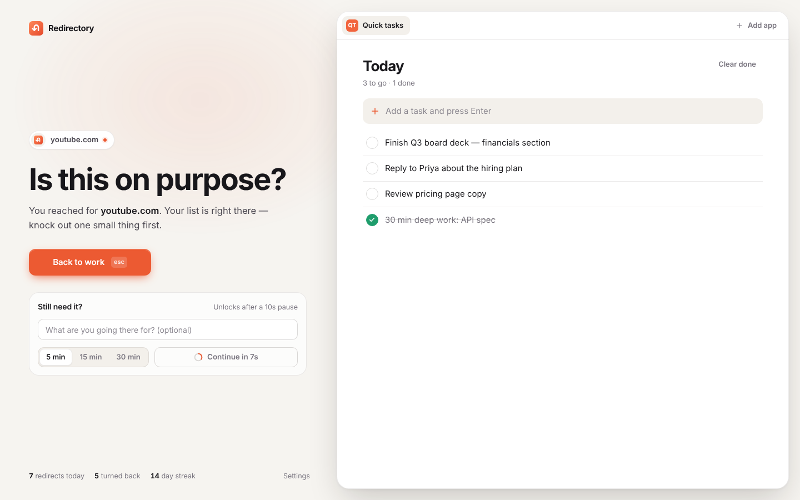
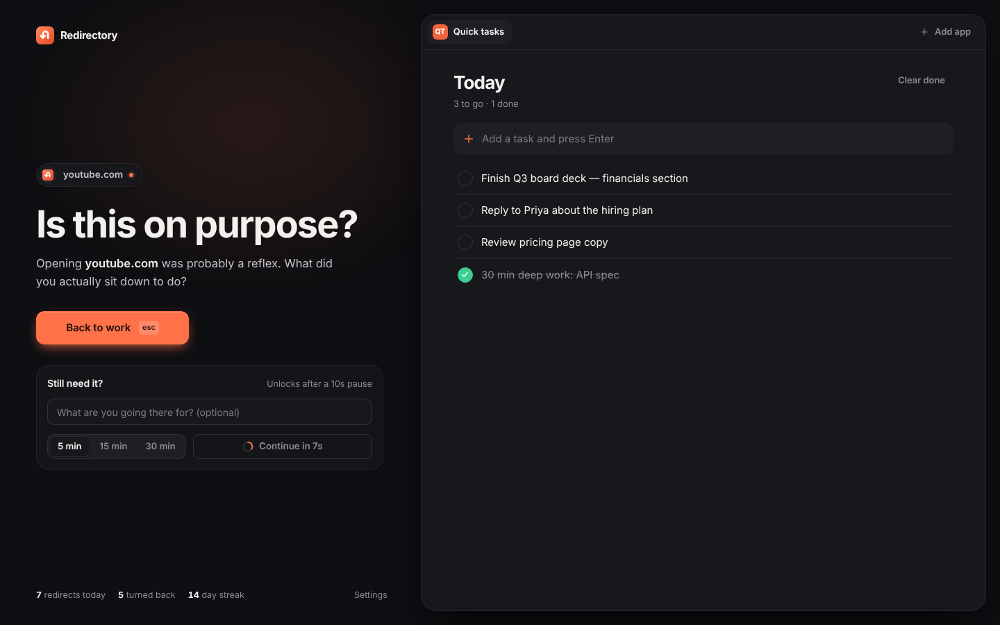

# Redirectory

**Block the sites that pull you off course. Land on your task list instead.**

Open YouTube on autopilot and you get a calm page asking whether you meant to, with your task app (Notion, Todoist, TickTick or the built-in list) right beside it. If you really need the site, you can still get through: wait out a short countdown, pick a time limit, and the site opens. When the time runs out, the tab goes back to the block page.



<p>
  
  
</p>

## Install (2 minutes)

1. Download or clone this repo.
2. Open `chrome://extensions` and switch on **Developer mode** (top right).
3. Click **Load unpacked** and select this folder (the one containing `manifest.json`).
4. Pin Redirectory from the puzzle-piece menu so it sits in your toolbar.

The settings page opens on first install. Pick a quick list, add your task app, and you're set.

## What it does

| | |
|---|---|
| **Block anything** | Type `youtube.com` to block it and every subdomain. Add a path to block only part of a site, e.g. `reddit.com/r/all` or `linkedin.com/feed`. You can paste a whole list at once. |
| **Quick lists** | One click each: Social media, Doomscrolling, Video & streaming, News, Shopping, Games & sports. |
| **Block page** | Big "Back to work" button (or press `Esc`) on the left, your focus panel on the right. |
| **Gated continue** | A countdown (default 10s) that only runs while the tab is in view, an optional "what for?" box, and time limits (shortest pre-selected). |
| **Time's up** | When an allowance ends, open tabs on that site go back to the block page. |
| **Focus panel** | Built-in quick tasks, or embed Notion, Todoist, TickTick, Google Tasks, Google Calendar, Microsoft To Do, Linear, Asana, Trello, ClickUp, or any URL. You can add several and switch between them with tabs. |
| **Pause, don't quit** | The popup offers pauses of 15 min, 1 hour, or the rest of the day, and blocking turns itself back on afterwards. A full off switch is in settings, deliberately out of the way. |
| **One-click block** | Click "Block site" in the popup, or right-click any page and choose "Block this site with Redirectory". |
| **Insights** | Redirects, times you turned back, and your turn-back rate over 14 days. All data stays on your device. |
| **Backup** | Export and import everything as JSON. |

## Embedding Notion, Todoist and the rest

Most task apps refuse to load inside other pages (`X-Frame-Options` / CSP `frame-ancestors`). Redirectory removes those two headers **only** for frames loaded by its own pages, plus navigations those apps make inside that frame (for sign-in redirects). Every other site on the web is unaffected. The test suite checks that a normal web page still can't frame a protected page.

Tips:
- **Sign in to the app in a normal tab first.** The embed uses your existing browser session.
- For Notion, paste the link to the exact page you want: a task database, a daily planner, etc.
- If an app still won't load, the panel has an "open in new tab" button. Google sign-in in particular refuses to run inside frames, so sign in to Google apps in a normal tab first.

## How it works

- **Manifest V3** with `declarativeNetRequest`. Blocked sites are redirected *before any request goes out*, so there's no flash of the site and nothing to bypass by being quick. The original URL travels in the block page's `#fragment`, so "Continue" takes you to the exact page.
- The background worker rebuilds the full rule set from storage on every change (serialized), instead of patching rules, so state and rules can't drift apart.
- Allowances and pauses expire via `chrome.alarms`, so they survive the worker sleeping.
- No build step and no dependencies. Plain ES modules.

```
manifest.json
src/background.js        service worker: rules, alarms, stats, messages
src/lib/                 pure logic (domains, rules, presets, embeds) + UI helpers
src/pages/blocked.*      the block page + focus panel
src/pages/popup.*        toolbar popup
src/pages/options.*      settings
tests/unit/              node:test, pure logic
tests/e2e/               Playwright: loads the real extension in Chromium
```

## Testing

```bash
npm test             # unit tests (pattern parsing, DNR rule generation, presets)
npm run test:e2e     # end-to-end in real Chromium (needs Playwright)
npm run screenshots  # regenerates docs/screenshots in light + dark
npm run package      # builds dist/redirectory-<version>.zip for the Web Store
```

The E2E suite loads the unpacked extension into Chromium and maps every hostname to a local server, so it exercises real navigations without the internet. It covers blocking (subdomains, lookalikes, paths), the countdown and reason gates, allowances expiring through real alarms, pause and the off switch, "Back to work" (go back, or close the tab), the popup and presets, embedding a site that sends `X-Frame-Options: DENY`, frame-busting protection, clickjacking protection on the block page, quick tasks, settings, and stats.

## Permissions, and why

| Permission | Why |
|---|---|
| `declarativeNetRequest` + all-sites host access | Redirect the sites you list (they can be any site) and let task apps load in the focus panel. |
| `storage` | Your list, settings, tasks and stats, stored locally only. |
| `alarms` | End allowances and pauses on time. |
| `tabs` | Send open tabs back to the block page when time's up; "Block site" for the current tab. |
| `favicon` | Show site icons from Chrome's own cache. No network requests. |
| `contextMenus` | The right-click "Block this site" item. |

Nothing leaves your browser. There are no analytics and no servers.

## Known limits

- Incognito: Chrome disables extensions there by default. To block in incognito, turn on "Allow in Incognito" on `chrome://extensions`.
- Anyone determined can switch the extension off at `chrome://extensions`. Redirectory adds friction; it isn't a lock.
- Embedding was verified against a local server that mimics Notion/Todoist's anti-framing headers. The sandbox this was built in couldn't reach those sites, so give your app a quick check after setup. If one misbehaves, "Any website" with a different URL (e.g. a specific Notion page) usually solves it.
