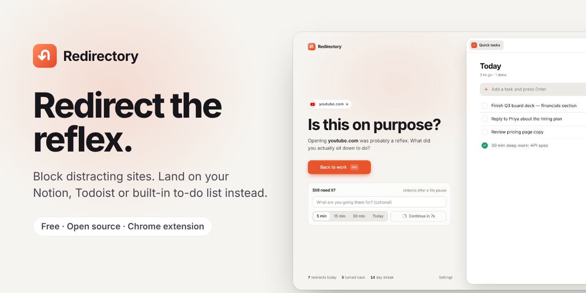
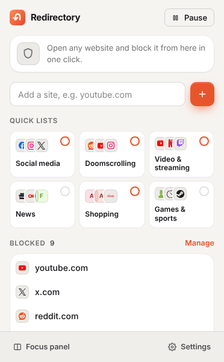
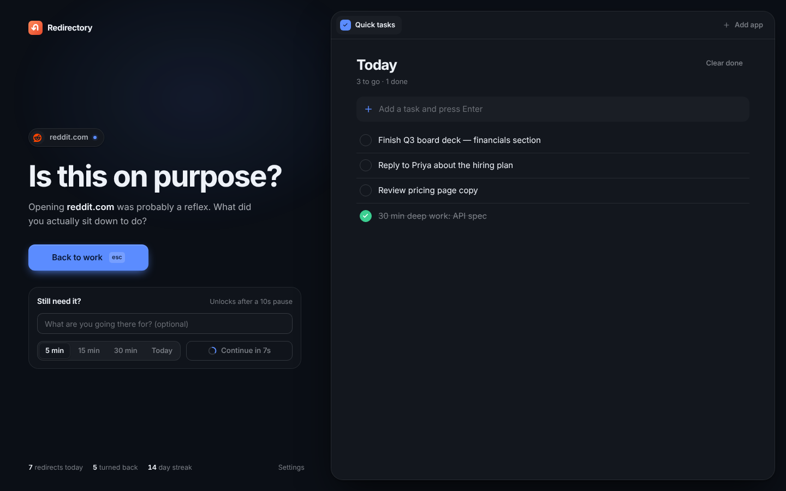

<div align="center">


# Redirectory

**A free, open-source website blocker for Chrome that shows your to-do list instead.**

Block YouTube, Reddit, X, Instagram — anything. When you reach for one, you land on Notion, Todoist, TickTick, Google Tasks or a built-in task list. Really need the site? Wait ten seconds and pick 5 minutes, 15, 30, or the rest of today.

[**Website**](https://tapariapurv.github.io/redirectory-chrome/) · [**Install**](#install) · [**Privacy**](https://tapariapurv.github.io/redirectory-chrome/privacy.html) · [**Changelog**](CHANGELOG.md)

[](https://github.com/tapariapurv/redirectory-chrome/actions/workflows/ci.yml)


[](LICENSE)




</div>

## Why Redirectory

Most site blockers are a wall you learn to climb. Redirectory is a speed bump with a better destination: the moment you open a distracting site on autopilot, the thing you *should* be doing is right in front of you.

- **Your tasks, not a wall.** The block page embeds Notion, Todoist, TickTick, Google Tasks, Google Calendar, Microsoft To Do, Linear, Asana, Trello, ClickUp or any URL. It also has a built-in list that works offline.
- **Friction that works.** "Continue" unlocks after a short countdown that only runs while you're looking at the tab. Optionally, name why you're going.
- **On your terms.** Allow a site for 5, 15 or 30 minutes, or the rest of today. When time's up, open tabs go back to the block page.
- **Private by design.** No account, no servers, no analytics. Everything stays in your browser.

## Features

| | |
|---|---|
| **Precise blocking** | `youtube.com` blocks the site and every subdomain. `reddit.com/r/all` blocks just that feed. Paste a whole list at once. |
| **Quick lists** | One click each: Social media, Doomscrolling, Video & streaming, News, Shopping, Games & sports. |
| **Block page** | "Back to work" (or press `Esc`) on the left, your focus panel on the right. Switch between several apps with tabs. |
| **Gated continue** | Countdown (default 10 s), optional reason, then 5/15/30 min or **rest of today**. Shortest is pre-selected. |
| **Time's up** | When an allowance ends, open tabs on that site return to the block page. |
| **Pause, don't quit** | Pause for 15 min, 1 hour or the rest of the day. Blocking turns itself back on. |
| **Real logos** | Official brand marks for task apps and 40+ popular sites, plus real favicons, cached, for everything else. |
| **Themes** | Ember, Ocean, Forest, Grape, Rose and Mono, each in light and dark, or following your system. |
| **Shortcuts** | <kbd>Alt</kbd>+<kbd>Shift</kbd>+<kbd>B</kbd> blocks the current site. <kbd>Alt</kbd>+<kbd>Shift</kbd>+<kbd>R</kbd> opens the popup. Right-click → "Block this site". |
| **Insights** | Redirects, times you turned back, and your turn-back rate over 14 days. |
| **Backup** | Export and import your list, settings, panels and tasks as JSON. |

<p align="center">
  
  &nbsp;
  
</p>

## Install

Redirectory isn't on the Chrome Web Store yet. Installing it from source takes two minutes:

1. [Download the ZIP](https://github.com/tapariapurv/redirectory-chrome/archive/refs/heads/main.zip) and unzip it (or `git clone` this repo).
2. Open `chrome://extensions` and switch on **Developer mode** (top right).
3. Click **Load unpacked** and select the folder that contains `manifest.json`.
4. Pin Redirectory from the puzzle-piece menu. The settings page opens on first install.

It also works in Edge, Brave, Arc, Vivaldi and Opera, or any Chromium browser with Manifest V3 support.

## Embedding Notion, Todoist and others

Most task apps refuse to load inside other pages (`X-Frame-Options` / CSP `frame-ancestors`). Redirectory removes those two headers **only** for frames loaded by its own block page, and for navigations those apps make inside that frame (sign-in redirects). Every other site on the web is unaffected, and a test checks that ordinary web pages still can't frame protected sites.

- **Sign in to the app in a normal tab first.** The embed uses your existing browser session.
- For Notion, paste the link to the exact page you want: a task database, a daily planner, etc.
- Google sign-in won't run inside a frame. Sign in to Google apps in a normal tab first.

## How it works

- **Manifest V3** with `declarativeNetRequest`: blocked sites are redirected *before any request is sent*, so the site never flashes on screen and there's nothing to race. The original URL travels in the block page's `#fragment`, so "Continue" opens the exact page you asked for.
- The background worker rebuilds the whole rule set from storage on every change, in order, instead of patching rules one by one. State and rules can't drift apart.
- Allowances and pauses end via `chrome.alarms`, which survives the service worker sleeping.
- The block page refuses to render inside a frame, so a website can't trick you into clicking "Continue" (clickjacking).
- No build step and no runtime dependencies. Plain ES modules.

```
manifest.json
src/background.js      service worker: rules, alarms, stats, favicons, shortcuts
src/lib/               pure logic (domains, rules, presets, brands, migration) + UI helpers
src/pages/             block page, popup, settings
src/assets/            icons, brand marks, Inter font
tests/unit/            node:test, pure logic
tests/e2e/             Playwright, loads the real extension in Chromium
docs/                  website (GitHub Pages), screenshots
```

## Development

```bash
npm install          # Playwright, for tests only
npm test             # unit tests
npm run test:e2e     # end-to-end in real Chromium
npm run screenshots  # regenerate docs/screenshots (light, dark, themes)
npm run og           # regenerate the social preview image
npm run package      # dist/redirectory-<version>.zip for the Web Store
```

The E2E suite maps every hostname to a local server, so it drives real navigations without the internet. It covers blocking (subdomains, lookalikes, paths), the countdown and reason gates, real alarm-driven expiry, rest-of-today, pause, "Back to work", popup and presets, embedding a site that sends `X-Frame-Options: DENY`, frame-busting and clickjacking protection, logos and favicon caching, themes, quick tasks, settings, and stats. See [CONTRIBUTING.md](CONTRIBUTING.md).

## Permissions, and why

| Permission | Why |
|---|---|
| `declarativeNetRequest` + all-sites access | Redirect the sites on your list (they can be any site), let task apps load in the focus panel, and fetch site icons. |
| `storage` | Your list, settings, tasks, theme and stats, stored locally only. |
| `alarms` | End allowances and pauses on time. |
| `tabs` | Send open tabs back to the block page when time's up; block the current tab. |
| `contextMenus` | The right-click "Block this site" item. |

There are no analytics and no servers. The only network requests outside your focus-panel apps are site-icon lookups, which send just a domain name. Full details are in the [privacy policy](https://tapariapurv.github.io/redirectory-chrome/privacy.html).

## Known limits

- **Incognito:** Chrome disables extensions there by default. Enable "Allow in Incognito" on `chrome://extensions` to block there too.
- **It isn't a lock.** Anyone can switch the extension off at `chrome://extensions`. Redirectory adds friction, by design.

## Credits

- Brand marks from [Simple Icons](https://simpleicons.org) (CC0). All logos are trademarks of their respective owners and are used only to identify those services.
- [Inter](https://rsms.me/inter/) typeface by Rasmus Andersson (SIL Open Font License).

## License

[MIT](LICENSE)
